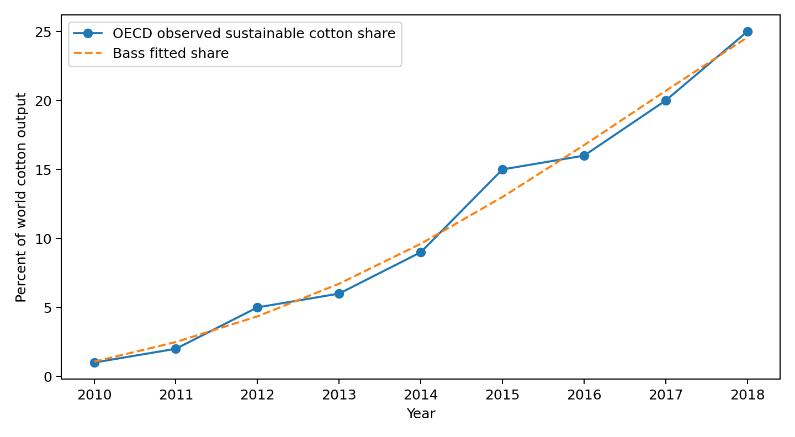
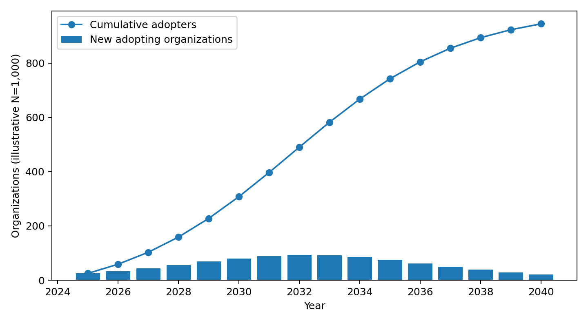

# Forecasting the Diffusion of Citizens of Humanity and Pili Eco-Indigo
**DS 223 Marketing Analytics | Bass Model Homework**
**Innovation:** TIME Best Inventions of 2025, Fashion | **Scope:** Global | **Unit:** Textile organizations (illustrative)

## Executive summary

This study evaluates the prospective diffusion of Citizens of Humanity and Pili Eco-Indigo, selected from TIME Best Inventions of 2025, Fashion. We use historical worldwide sustainable/organic cotton production shares (OECD-FAO, 2010-2018) as a related textile-sector diffusion proxy. A constrained nonlinear least-squares Bass fit produces p=0.02158, q=0.33026 and historical proxy market potential M=0.422 of global cotton output. We transfer only p and q to Eco-Indigo. Under an illustrative addressable market of 1,000 textile organizations, the model projects 944 cumulative adopters by 2040. These numbers are scenarios, not measured Eco-Indigo adoption or validated forecasts.

## 1. Innovation selected

The selected innovation is Citizens of Humanity and Pili Eco-Indigo, listed by TIME on October 9, 2025 in its Fashion category. It is a bio-based indigo dye created using fermentation and subsequent chemistry instead of relying on petroleum feedstocks. TIME describes its use in denim and reports the first garments launched in January 2025. Exact entry: https://time.com/collections/best-inventions-2025/7318322/citizens-of-humanity-and-pili-eco-indigo/?filters=Fashion. PILI and Citizens of Humanity describe it as a drop-in replacement for conventional indigo in existing denim dyeing processes. Sources: TIME [1], Pili [2], Citizens of Humanity [3].

## 2. Historical look-alike and justification

The look-alike is the adoption of sustainable and organic cotton sourcing in global cotton production. Both innovations are production-side substitutions within textile supply chains that can be adopted by mills, brands and upstream producers to reduce environmental impacts while preserving a conventional end product. Both may spread through buyer requirements, peer learning, certification, supplier capability and economies of scale. They are NOT technologically identical: sustainable cotton concerns agricultural production and certification, while Eco-Indigo concerns biochemical pigment manufacture and denim dyeing. Their costs, regulations, capacity constraints and diffusion clocks differ. Thus this is an industry-behavior proxy, not a direct prediction validated on bio-indigo data.

## 3. Historical data and scope

The scope is worldwide textile supply chains, rather than Armenia or the United States, because the PILI-Citizens of Humanity-Orta collaboration spans France, the US and Turkey and Eco-Indigo can be supplied to mills across countries. The OECD-FAO Agricultural Outlook 2022-2031, Cotton chapter, Table 10.1, reports sustainable AND organic cotton production as a percentage of global cotton output for 2010-2018. The data are production-volume shares, not a count of adopting mills. The published shares are rounded integers; we use those published values as given. Do not interpret sustainable/organic cotton as organic-only. Original source [4].

## 4. Bass model and estimation

As in the DS 223 lecture, the Bass hazard is f(t)/(1-F(t)) = p + qF(t), and F(t)=[1-exp(-(p+q)t)]/[1+(q/p)exp(-(p+q)t)]. Let y_t be the observed fraction of world cotton output produced under sustainable or organic programs. Estimate p, q and m by minimizing sum_t [y_t - m F(t;p,q)]^2, with p>0, q>0 and 0.251<=m<=1. Set t=1 for 2010, t=9 for 2018; this time-origin choice is an assumption because diffusion started before 2010. Constrained nonlinear least squares gives p=0.021575 per year, q=0.330257 per year, and m=0.422154 (42.22% of world cotton output). In-sample RMSE is 0.869 percentage points. Here m is an asymptotic PRODUCTION SHARE for the proxy; it is not the number of firms and cannot be transferred as a market-size estimate. Parameter uncertainty is high because only nine rounded annual observations are available and the diffusion origin is unknown.

## 5. Transfer and forecast assumptions

The Eco-Indigo adoption unit is a distinct textile organization (brand or mill) that first implements Eco-Indigo. This is not the number of jeans sold, consumers buying denim, or tonnes of dye. We assume a global addressable pool of 1,000 such organizations solely as an explicit Fermi scenario, not as a measured statistic. We take t=1 as 2025, reflecting first commercial garments in January 2025. We carry over p and q from the historical proxy, reset the adoption fraction to F(0)=0, and define cumulative organizations A_t=N F(t). Annual new adopters are A_t-A_(t-1), not N*f(t) evaluated at a point (the latter is an instantaneous rate). Fermi market construction: assume 20 relevant denim-producing markets x 50 potential adopting organizations per market = 1,000. Both factors are hypothetical scenario inputs; there is no source supporting these as actual counts. Source [2] supports the 2025 commercial launch, not the market-size assumptions.

## 6. Diffusion interpretation

The forecast accelerates as imitation effects dominate early adoption, then slows as the remaining pool shrinks. The highest forecast number of annual new adopters is 93 organizations in 2032. The projected 2030 cumulative count is 308 of the assumed 1,000; 2040 is 944. These are illustrative estimates. If actual Eco-Indigo manufacturing capacity, economics or regulation differs from the proxy, the adoption curve may shift materially.

## 7. Sensitivity, limitations and conclusion

The adoption count scales linearly with assumed addressable market size: 500, 1,000 or 2,000 organizations. Changing p and q or the assumed start year changes the timing, too. Key limitations: production share is not adopter count; sustainable cotton and biotech dye have different incentives; only nine historical years; observed series may include policy and weather shocks; initial 2010 adoption is nonzero; market size is hypothetical; adoption may be reversed or occur at different levels (brands versus mills). Accordingly this project demonstrates the Bass modeling procedure, rather than making a statistically validated sales forecast. A better follow-up study would obtain annual counts of denim mills actually using bio-based indigo, number of commercial customers, and kilograms of Eco-Indigo purchased.

## Historical data: published OECD-FAO series

| Year | Sustainable and organic cotton (% of world cotton) | Bass fitted (%) |
|---|---:|---:|
| 2010 | 1 | 1.06 |
| 2011 | 2 | 2.49 |
| 2012 | 5 | 4.35 |
| 2013 | 6 | 6.72 |
| 2014 | 9 | 9.61 |
| 2015 | 15 | 13.00 |
| 2016 | 16 | 16.76 |
| 2017 | 20 | 20.70 |
| 2018 | 25 | 24.58 |

## Forecast: illustrative number of adopting textile organizations

| Year | New organizations | Cumulative organizations | Penetration (%) |
|---|---:|---:|---:|
| 2025 | 25 | 25 | 2.52 |
| 2026 | 34 | 59 | 5.89 |
| 2027 | 44 | 103 | 10.30 |
| 2028 | 56 | 159 | 15.91 |
| 2029 | 69 | 228 | 22.77 |
| 2030 | 80 | 308 | 30.80 |
| 2031 | 89 | 397 | 39.70 |
| 2032 | 93 | 490 | 49.03 |
| 2033 | 92 | 582 | 58.22 |
| 2034 | 85 | 667 | 66.74 |
| 2035 | 75 | 742 | 74.22 |
| 2036 | 62 | 805 | 80.46 |
| 2037 | 50 | 855 | 85.47 |
| 2038 | 39 | 893 | 89.35 |
| 2039 | 29 | 923 | 92.28 |
| 2040 | 22 | 944 | 94.45 |

## Market-size sensitivity

| Assumed addressable organizations | Year | Cumulative adopting organizations |
|---:|---:|---:|
| 500 | 2030 | 154 |
| 500 | 2035 | 371 |
| 500 | 2040 | 472 |
| 1000 | 2030 | 308 |
| 1000 | 2035 | 742 |
| 1000 | 2040 | 944 |
| 2000 | 2030 | 616 |
| 2000 | 2035 | 1484 |
| 2000 | 2040 | 1889 |

## References

[1] TIME (2025). Citizens of Humanity and Pili Eco-Indigo. https://time.com/collections/best-inventions-2025/7318322/citizens-of-humanity-and-pili-eco-indigo/?filters=Fashion
[2] Pili (2025). Pili Partners with Citizens of Humanity and Orta. https://www.pili.bio/en/pili-partners-with-citizens-of-humanity-and-orta-to-revolutionize-the-denim-industry-with-biobased-indigo/
[3] Citizens of Humanity. ECO-INDIGO. https://citizensofhumanity.com/pages/eco-indigo
[4] OECD-FAO (2022). Agricultural Outlook 2022-2031, Cotton, Table 10.1. https://www.oecd.org/en/publications/oecd-fao-agricultural-outlook-2022-2031_f1b0b29c-en/full-report/component-13.html
[5] Hovhannisyan, K. DS 223 Marketing Analytics: Bass Model for Innovation Diffusion (provided lecture).

## Reproducibility
Run `pip install -r requirements.txt` then `python analysis.py` from the project root. The data file `data/sustainable_cotton.csv` transcribes OECD-FAO Table 10.1; `analysis.py` fits and exports all figures and tables.